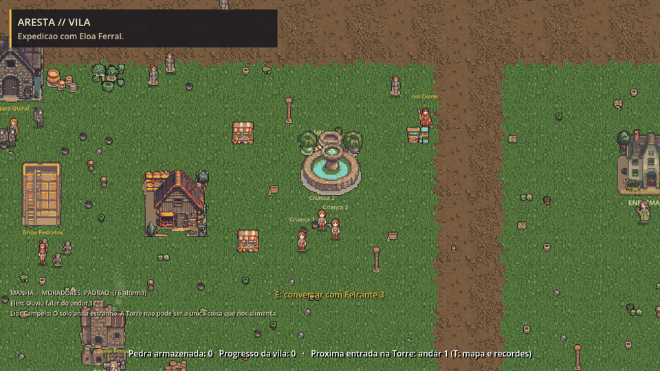
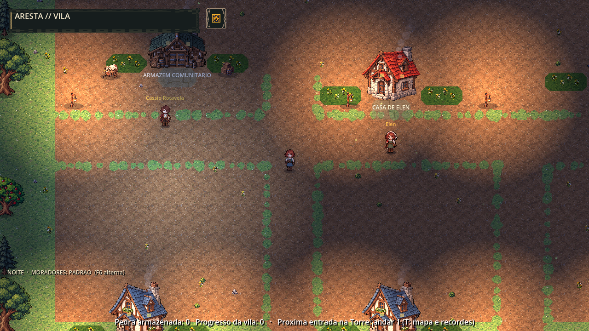
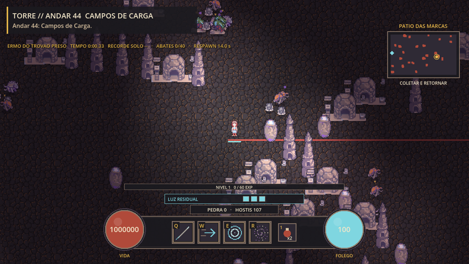
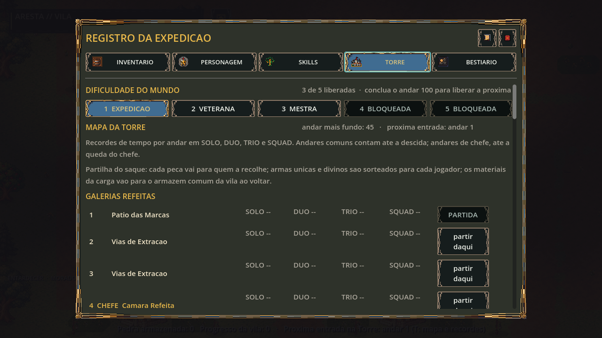
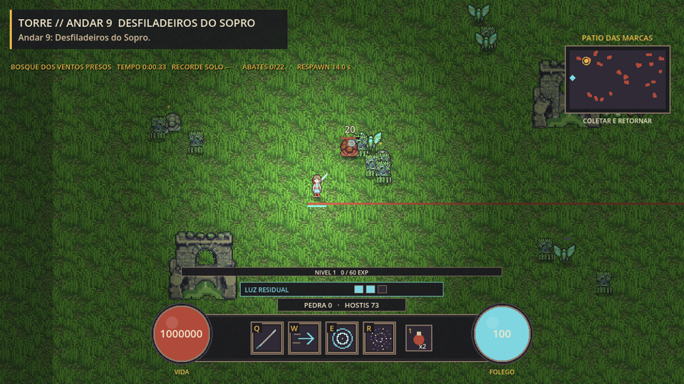
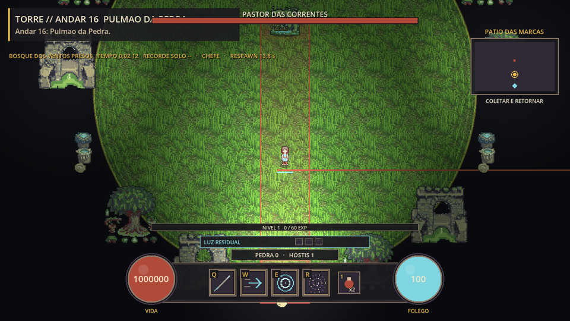
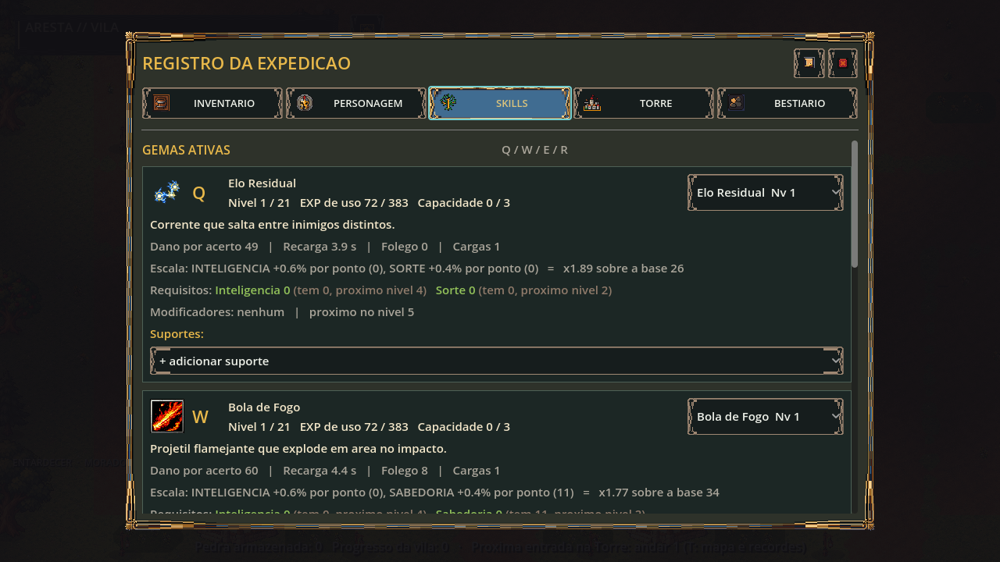
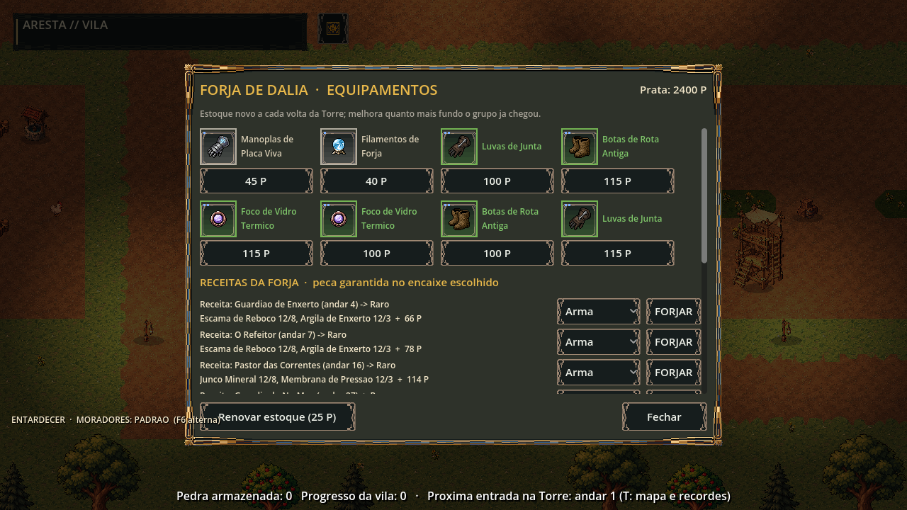
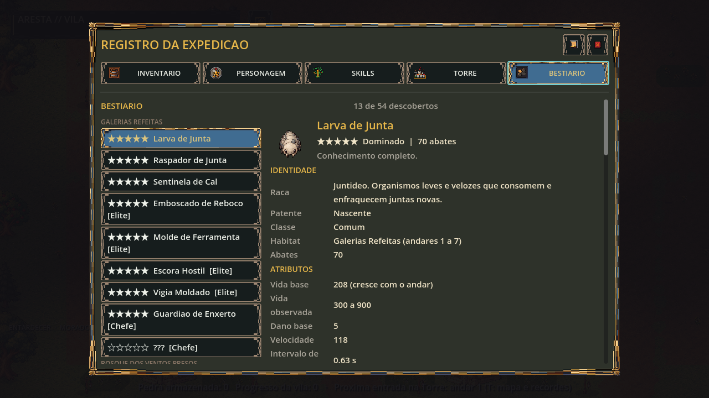

# Aresta — A Torre das Cem Marcas

RPG de ação roguelike em pixel art para **um a quatro jogadores**, solo ou em cooperativo online. Na vila de Aresta, você monta seu quadro de expedição e desce a **Torre das Cem Marcas**: cem andares, dez biomas, um chefe guardando o fim de cada região e uma vila que se lembra do que você fez.



> **Estado:** beta jogável em desenvolvimento (Godot 4.6.3, GDScript). Números de combate, saque e progressão são provisórios e servem para playtest.

[Baixar playtest para Windows, Linux ou macOS](https://github.com/matheus013/torre-das-cem-marcas/releases)
sem instalar Godot. Veja [instruções e limitações](docs/playtest-publico.md).
Commits publicáveis na `main` geram versões SemVer e [changelog](CHANGELOG.md)
automaticamente, após testes e boot nativo nos três sistemas. Veja as
[regras de release](docs/releases-github.md). Assinatura comercial e QA gráfico seguem pendentes.

Preparação para distribuição: [roadmap Steam em acesso antecipado](docs/roadmap-steam-acesso-antecipado.md) e [registro de execução](docs/steam-ea-execucao.md). Builds release: `sh tools/release/build.sh all` (Windows e Linux; exige templates Godot 4.6.3). Artefatos em `builds/` ainda precisam de QA antes da publicação.

---

## Sumário

- [Como instalar e abrir](#como-instalar-e-abrir)
- [Como jogar](#como-jogar)
  - [Objetivo](#objetivo)
  - [Controles](#controles)
  - [As quatro personagens](#as-quatro-personagens)
  - [A vila de Aresta](#a-vila-de-aresta)
  - [A Torre](#a-torre)
  - [Dificuldades](#dificuldades)
  - [Resistências e fraquezas](#resistências-e-fraquezas)
  - [Chefes](#chefes)
  - [Gemas: suas habilidades](#gemas-suas-habilidades)
  - [Níveis, atributos e árvores de evolução](#níveis-atributos-e-árvores-de-evolução)
  - [Saque e equipamento](#saque-e-equipamento)
  - [Loja e receitas da Forja](#loja-e-receitas-da-forja)
  - [Bestiário](#bestiário)
  - [Cair e morrer na Torre](#cair-e-morrer-na-torre)
  - [Recordes](#recordes)
- [Cooperativo online](#cooperativo-online)
- [Moradores com IA](#moradores-com-ia)
- [Para desenvolvedores](#para-desenvolvedores)
- [Licença](#licença)

---

## Como instalar e abrir

1. Instale o **[Godot 4.6.3](https://godotengine.org/download/archive/4.6.3-stable/)** (versão padrão, não a .NET).
2. Clone o repositório:

   ```sh
   git clone https://github.com/matheus013/torre-das-cem-marcas.git
   cd torre-das-cem-marcas
   ```

3. Abra o jogo:

   ```sh
   godot --path . -- --public
   ```

   Isso abre a **tela de título**, como um jogador veria. Sem `-- --public`, o jogo abre no **modo dev**, com laboratório de build, editores de conteúdo e provas técnicas. Para ir direto à vila, use `godot --path . res://src/prototype/village/village_exploration.tscn`.

   Também dá para abrir a pasta pelo editor do Godot (**Importar** → `project.godot`) e apertar **F5**.

Na tela de título:

| Botão | O que faz |
|---|---|
| **CONTINUAR** | volta ao mundo salvo (aparece quando há save; mostra personagem, nível, andar mais fundo e data) |
| **JOGAR** / **NOVO JOGO** | Aresta e a Torre em solo; com save existente vira **NOVO JOGO** e pede confirmação |
| **HOSPEDAR CO-OP** | abre seu mundo para até três amigos (porta 7777) |
| **ENTRAR EM CO-OP** | entra no mundo de um amigo pelo IP |
| **MORADORES (IA)** | escolhe o modo dos moradores: padrão ou com modelo de linguagem |
| **OPÇÕES** | vídeo, limite de FPS, VSync, volumes, controles, mira e ataque automáticos; preferências persistem entre sessões |

O mundo é **salvo automaticamente** a cada minuto, ao entrar ou sair da Torre, ao trocar de andar e ao fechar a janela.

---

## Como jogar

### Objetivo

Desça a Torre andar por andar, sobreviva às hordas, recolha o saque e volte vivo para Aresta. Cada pedra regenerativa entregue fortalece a vila. Cada andar alcançado fica liberado como ponto de partida. Cada chefe derrotado abre o caminho para o próximo bioma. O fundo fica no **andar 100**; concluí-lo libera a próxima das **cinco dificuldades**.

### Controles

As teclas abaixo são os padrões. Em **OPÇÕES → Controles**, selecione uma ação e pressione a nova tecla; **Aplicar** grava a mudança. **Nenhuma tecla pode servir a duas ações**, mesmo em contextos diferentes. **Esc** cancela a captura e permanece reservado para a pausa.

| Tecla | Ação |
|---|---|
| **Botão direito do mouse** (ou setas) | andar até o ponto; mantenha pressionado para seguir o cursor |
| **Botão esquerdo do mouse** ou **Espaço** | ataque normal na direção do cursor; segure para repetir no ritmo da arma |
| **Q, W, E, R** | usar as quatro Gemas Ativas na direção do cursor |
| **1** | item rápido de cura (na Torre) |
| **F** | conversar com o morador mais próximo / investigar |
| **I** | inventário e equipamento |
| **C** | personagem: atributos, evoluções e status detalhados |
| **G** | gemas: encaixes, suportes e maestria |
| **T** | Torre: dificuldade, mapa, recordes e andar de partida |
| **B** | bestiário |
| **V** | trocar de personagem (fora da Torre) |
| **H** | ligar/desligar a mira automática no inimigo vivo mais próximo |
| **J** | ligar/desligar o ataque automático no inimigo mais próximo (começa ligado) |
| **F5 / F9** | salvar / carregar o mundo (solo ou host) |
| **F6** | alternar os moradores entre modo padrão e com IA (solo ou host) |
| **Esc** | abrir opções e pausar no solo; no co-op o mundo continua. **Voltar ao menu** encerra a sessão (o host salva antes) |

O mapeamento inicial de controle usa os botões normalizados de Xbox e PlayStation:

| Ação | Xbox | PS4 / PS5 |
|---|---|---|
| Movimento / mira | analógico esquerdo / direito | analógico esquerdo / direito |
| Gemas 1 a 4 | LB, RB, X, Y | L1, R1, quadrado, triângulo |
| Ataque normal | B | círculo |
| Conversar / confirmar | A | cruz |
| Item rápido | RT | R2 |
| Inventário | View | Share / Create |
| Personagem / gemas / Torre / trocar personagem | direcional cima / esquerda / baixo / direita | direcional cima / esquerda / baixo / direita |
| Pausa | Menu / Start | Options |
| Alternar mira automática | clicar analógico esquerdo (L3) | L3 |

Salvar, carregar e alternar moradores também estão na aba **Sessão** das opções. Mira e ataque automáticos são opcionais e conservam a preferência. A navegação dos menus aceita direcional/analógico e confirmação/cancelamento. A configuração de IP do co-op e de provedores de IA ainda exige entrada de texto. Compatibilidade por USB/Bluetooth com controles físicos precisa de QA antes de anunciar suporte completo na Steam.

### As quatro personagens

Ao abrir o jogo você escolhe quem desce. Não existem classes: qualquer personagem usa qualquer gema e equipamento. O que muda é a **Passiva Autoral**, única de cada uma:

| Personagem | Passiva | Como funciona |
|---|---|---|
| **Eloa Ferral** | Luz Residual | acertos deixam resíduos de luz; a próxima gema os conduz até inimigos próximos |
| **Sena Rotavela** | Duas Correntes | repetir a mesma gema acumula Traçado (mais potência); variar acumula Desvio (mais velocidade, menos Fôlego) |
| **Cira Salvedra** | Placas Adaptativas | dano recebido vira uma amostra que reduz golpes, fortalece a próxima gema e, cheia, explode em área |
| **Rui Pedralva** | Oportunidade Estrutural | acertos perto de obstáculos revelam pontos no chão; pisar neles dá barreira e causa um impacto |

### A vila de Aresta

Aresta é seu porto seguro: casas, feira, forja, enfermaria, conselho, arquivo, plantações e trinta moradores com trabalho, casa e rotina. O período do dia avança a cada volta da Torre; à noite os lampiões acendem e a vila se recolhe.

- Converse com os moradores com **F**. Eles lembram suas expedições, pedras entregues, quedas e recordes.
- **Gemas e suportes só podem ser trocados na vila.** Na Torre o loadout fica travado.
- Ao voltar, os **materiais** da carga vão para o **armazém** comum da vila; equipamentos já vão direto para a sua mochila.
- Na **Forja da Dália** há loja de equipamentos e receitas que usam os materiais do armazém (veja abaixo).
- A entrada da Torre fica no edifício alto ao leste.



### A Torre

São cem andares em dez biomas: Galerias Refeitas, Bosque dos Ventos Presos, Manto dos Esporos, Bacias do Quarto Pulso, Ermo do Trovão Preso, Arquivo das Rotas Mortas, Planície dos Adormecidos, Eixos Partidos, Campos do Quase e Obra Inacabada. Cada um tem monstros, materiais e um perigo de ambiente próprios.

- **Andares comuns são grandes.** Explore, ache matilhas e derrote monstros. Fora de combate eles patrulham; quando você chega perto, partem para cima.
- **Sobreviva 10 minutos:** a escada para o próximo andar só abre depois de o grupo sobreviver 10 minutos no andar (contagem *SOBREVIVA m:ss* no topo da tela e no minimapa).
- **Respawn acelera:** os monstros voltam rápido, e cada vez mais rápido quanto mais tempo você fica no andar.
- **Perigos do bioma** aparecem como áreas laranja no chão (rajadas de vento, nuvens de esporos, descargas). Saia delas antes que o aviso se complete.
- **Portal de retorno:** na entrada de cada andar, leva você de volta a Aresta com tudo que carrega.
- Quanto mais fundo, mais fortes os monstros; números grandes aparecem abreviados (12,4 mil; 3,2 mi; 1,7 bi).



### Dificuldades

O mundo tem **cinco dificuldades**: Expedição, Veterana, Mestra, Mítica e Cicatriz. O host escolhe no topo da aba **Torre** (**T**), com todos fora da Torre; cada uma é liberada ao **concluir o andar 100** na anterior. Andar mais fundo, andar de partida e recordes ficam separados por dificuldade.

| | 1 Expedição | 2 Veterana | 3 Mestra | 4 Mítica | 5 Cicatriz |
|---|---|---|---|---|---|
| Vida dos inimigos | ×1 | ×30 | ×1.000 | ×30.000 | ×100.000 |
| Dano dos inimigos | ×1 | ×2 | ×4 | ×8 | ×16 |
| Resistências dos inimigos | +0% | +10% | +20% | +30% | +40% |
| Suas resistências | 0 | 0 | −20% | −40% | −60% |
| Saque e EXP | ×1 | ×1,25 / ×1,5 | ×1,5 / ×2 | ×2 / ×3 | ×2,5 / ×4 |
| Armas únicas | não | sim | sim | sim | sim |

Na **4** e na **5** a patente mais fraca some, elites e chefes **se adaptam** ao tipo de dano que mais os fere, e aparecem **bandos superiores**: matilhas uma patente acima, todas com afixos e com um **anel brilhante no chão**. Valores provisórios para playtest.



### Resistências e fraquezas

Todo dano tem tipo: físico, fogo, gelo, raio, ácido, natureza, trevas, sagrado, terra ou arcano. Cada monstro resiste (ou é fraco) conforme a raça e o bioma, de −50% a +75%. Números **amarelos e maiores** indicam fraqueza; **cinza**, golpe muito resistido. O alvo da mira mostra *FRACO* e *RESISTE* na HUD.

- **Penetração** (afixo) reduz só resistências positivas; **Quebra elemental** reduz por alguns segundos.
- Você resiste com afixos de resistência (a tudo ou por tipo), até **75%**. Ataques inimigos têm tipo: corpo a corpo e projéteis pela raça; perigos e chefes pelo bioma.
- Resistências, fraquezas e tipo de dano de cada monstro ficam no **bestiário**; as suas, nos **status detalhados**.



### Chefes

Cada região termina num **chefe em arena pequena**: Guardião de Enxerto (andar 4), O Refeitor (7), Pastor das Correntes (16), Guardiã do Nó-Mãe (27), Guardião da Comporta (39), Coroa dos Condutores (51), Guardião do Marco Cego (63), Pálpebra do Horizonte (72), Guardião do Eixo Zero (81), Guardião da Última Escolha (93) e o Regente Centésimo (100).

- A saída fica **selada** até o chefe cair.
- Ataques de área são anunciados por **formas vermelhas no chão** que se preenchem até o golpe: círculos, anéis (no anel, o seguro é colado ao chefe), linhas, cruzes, investidas, chuvas de área e puxões.
- Chefes mudam de fase ao perder vida e entram em **fúria** se a luta demora.
- Em grupo, ganham combinações de ataque extras.
- O chefe volta sempre que o grupo entra de novo no andar dele, para quem quer repetir a luta.
- Cada vitória pode entregar uma **gema** do conjunto do chefe; depois de uma vitória sem gema, a próxima garante uma.



### Gemas: suas habilidades

As quatro teclas **Q, W, E, R** usam **Gemas Ativas** (projétil, investida, explosão, campo, barreira, corrente, invocação, santuário, órbita, mina, meteoro, Saraivada, venenos e mais). Cada personagem começa com uma gema própria; as outras vêm dos **chefes**. Na aba **Gemas** (**G**), dentro da vila, você pode:

- trocar a gema de cada tecla;
- encaixar **Gemas de Suporte** (projéteis extras, perfuração, ricochete, área maior, eco, roubo de vida…), conforme a capacidade da gema;
- ver o **dano por acerto** já escalado e a **prévia** de cada suporte ou escolha ("Dano 55 → 66 (+20%)").

**Maestria:** cada gema sobe do nível 1 ao 21 pelo próprio uso (lançamentos e abates). Nos níveis **5, 10, 15 e 20** você escolhe 1 de 3 modificadores e no **21**, 1 de 2 grandes modificadores. Níveis altos pedem atributos; sem eles, a gema age no maior nível cumprido.



### Níveis, atributos e árvores de evolução

- Personagens vão do **nível 1 ao 100**. Cada nível dá **+5 de Vida** e mais potência.
- Níveis comuns dão **5 pontos de atributo** (Vitalidade, Força, Inteligência, Agilidade, Sorte, Sabedoria). Cada gema escala com os atributos que declara.
- Os níveis **10, 20 … 100** oferecem uma **evolução** entre seis opções: Essência (fortalece a passiva), Adaptação (sobrevivência) e Convergência (grupo). Toda opção do nível 100 é uma mecânica nova.
- Ao chegar a um marco, a simulação pausa e a tela de escolhas abre automaticamente; o jogo retoma depois das escolhas dos jogadores conectados.
- Os atributos mostram os pontos distribuídos e, entre parênteses, o bônus do equipamento. **STATUS DETALHADOS** abre a tabela completa (base, equipamento, total, efetivo, combate, resistências e bônus de dano). **RESETAR ATRIBUTOS** devolve todos os pontos distribuídos.

### Saque e equipamento

- Catálogo atual: [46 gemas ativas e 40 suportes](docs/catalogo-gemas.md). O autoataque também aceita suportes, na seção **AUTOATAQUE** da aba **Gemas**.
- Cada personagem inicia com um [tipo de arma distinto](docs/armas-e-afinidades.md), com escala por atributos e afinidades.
- O saque **cai no chão**: passe por cima para recolher. Um **filtro de saque** deixa no chão o que estiver abaixo da raridade escolhida.
- **13 encaixes:** arma, offhand, amuleto, armadura, luvas, botas, calça, **2 anéis** e **4 relíquias**.
- Raridades: Comum, Incomum, Raro, Épico e Lendário. Cada peça sorteia **afixos** (1 a 4, conforme a raridade) e tem **nível do item** igual ao andar onde caiu.
- Equipamentos têm **fabricação** (Improvisada, Regular, Refinada, Magistral), que aumenta os bônus da peça.
- **Lendários, armas únicas e relíquias mudam regras**, não só números: a Bola de Fogo vira um sol que segue você, gemas passam a custar Vida, recargas só andam com abates, e assim por diante ([lista completa](docs/itens-lendarios.md) e [critério](docs/game-design/77-revisao-revolucionaria-de-itens.md)). Armas únicas caem da dificuldade 2 em diante.
- Na aba **Inventário** (**I**): clique para equipar, botão direito para vender, **VENDER TUDO** (nunca vende equipados, lendários ou únicos) e **autovenda** ao voltar à vila. O mouse sobre uma peça compara com a equipada.

### Loja e receitas da Forja

Fale com a **Dália** na Forja e escolha **Ver equipamentos à venda**:

- **Vitrine** de 8 peças até épico, com afixos já sorteados, por 5× o preço de venda. Renova a cada volta da Torre ou na hora por 25 de prata; melhora quanto mais fundo o grupo já foi.
- **Receitas:** cada chefe vencido libera uma receita que troca **materiais do armazém** e prata por uma **peça garantida no encaixe escolhido** (rara antes do andar 40, épica depois). A dica de cada material diz quais monstros o derrubam.



### Bestiário

A aba **Bestiário** (**B**) lista todos os monstros da Torre por bioma. Quanto mais você abate um tipo, mais a ficha revela, em cinco níveis: identidade, atributos, comportamento e defesas (incluindo resistências e habilidades dos chefes), saque com chances e, por fim, o saque e os afixos realmente observados.



### Cair e morrer na Torre

- **Em grupo:** com vida zero você **cai** por 20 segundos (14 na segunda queda, 8 na terceira). Um aliado parado ao seu lado por 3 segundos o **estabiliza**; você volta com 25% de vida e um Ferimento de Expedição (−10% de vida máxima até voltar à vila).
- **Derrota:** em solo, na quarta queda, se a janela acabar ou se o grupo inteiro cair, você volta a Aresta e **sua carga fica no chão** onde caiu. Volte ao mesmo andar para recuperá-la. Experiência e equipamento equipado não se perdem.
- Fora de combate, depois de 4 segundos sem levar dano, a vida se recupera aos poucos.

### Recordes

O tempo de cada andar entra nos recordes da aba **Torre** (**T**), separados por **SOLO, DUO, TRIO e SQUAD** e por dificuldade. Andares comuns contam até a descida; andares de chefe, até a queda do chefe. Na mesma aba você escolhe em que andar já alcançado começa a próxima descida.

---

## Cooperativo online

Até quatro jogadores no mesmo mundo, com host autoritativo.

- **Hospedar:** tela de título → **HOSPEDAR CO-OP**. Libere a porta **7777** (UDP) se jogar pela internet.
- **Entrar:** tela de título → **ENTRAR EM CO-OP** → IP do host (`127.0.0.1` na mesma máquina).

Regras do grupo:

- cada personagem só pode estar com um jogador;
- a escada leva todo o grupo para o próximo andar;
- a experiência vai para todos no andar; cada peça é de quem a recolhe; armas únicas e divinos são sorteados para cada jogador; os materiais vão para o armazém comum;
- a dificuldade do mundo é a do host;
- o desafio também cresce com o tamanho do grupo (mais monstros, elites e chefes mais resistentes);
- o host valida e limita os comandos de cada cliente;
- quem cair da conexão tem 60 segundos para voltar com a mesma personagem;
- o mundo, o salvamento e os recordes ficam com o host.

Para testar sozinho com quatro janelas, cada uma jogada por um agente:

```sh
sh tools/play_local_coop.sh
```

---

## Moradores com IA

Os moradores têm dois modos (botão **MORADORES (IA)** ou **F6** durante o jogo):

- **Padrão:** a mente sistêmica do jogo decide o que cada morador faz e as falas são escritas à mão, usando fatos reais da sua campanha. Não precisa de nada além do jogo.
- **Com IA:** um modelo de linguagem escolhe entre as mesmas ações permitidas e escreve a fala com a personalidade de cada morador. Se o modelo falhar ou demorar, o modo padrão assume.

Provedores aceitos:

| Provedor | Exemplo de configuração |
|---|---|
| **Ollama** (local ou na rede) | endereço `http://127.0.0.1:11434`, modelo `qwen2.5:3b` (`ollama pull qwen2.5:3b`) |
| **Compatível com OpenAI** (LM Studio, llama.cpp, vLLM) | endereço do servidor, rota `/v1/chat/completions` |
| **Anthropic** | modelo `claude-haiku-4-5-20251001`, chave na variável `ANTHROPIC_API_KEY` |

A chave de API **nunca é gravada**: o jogo guarda só o nome da variável de ambiente. Também dá para configurar por linha de comando:

```sh
godot --path . -- --public --npc-mode=ia --npc-provider=ollama --npc-url=http://127.0.0.1:11434 --npc-model=qwen2.5:3b
```

---

## Para desenvolvedores

### Estrutura

| Pasta | Conteúdo |
|---|---|
| `src/gameplay/` | simulação autoritativa do mundo (`world/world_simulation.gd`), andares, gemas, progressão, saque e encontros |
| `src/simulation/npc/` | mente dos NPCs e vida da vila |
| `src/core/` | rede, modo dev e cliente de IA dos moradores |
| `src/prototype/village/` | cena principal: apresentação, sessão online, HUD e menus |
| `data/` | conteúdo do beta, da Torre e da vila (gerados por `tools/content/`) |
| `assets/sprites/` | sprites processados (gerados no PixelForge) |
| `docs/` | game design, arquitetura (ADRs) e roadmap |
| `tests/` | testes headless e provas de rede |
| `tools/` | geradores de conteúdo, pipeline de arte, benchmark e jogo local em co-op |

### Testes e balanceamento

```sh
sh tests/run_all.sh    # todos os testes headless e as provas de rede (host + 3 clientes)
godot --headless --path . --script tools/bench/balance_probe.gd             # sonda de balanceamento em solo
godot --headless --path . --script tools/bench/balance_probe.gd -- --party=4  # e em grupo
```

`tests/run_all.sh` também roda a auditoria estrita de gameplay (`tools/bench/gameplay_audit.gd -- --strict`), que falha enquanto houver achados. O GitHub Actions roda tudo a cada push em `main` (`.github/workflows/tests.yml`); os builds de distribuição (`.github/workflows/release-build.yml`) guardam os pacotes por 3 dias.

### Atalhos de desenvolvimento

- Modo dev (padrão): menu com Laboratório de Build, Central de Conteúdo e provas técnicas. `-- --public` mostra a tela pública; na tela pública, **F12** volta ao modo dev.
- **F7** (modo dev): ganha a experiência de um nível.
- Argumentos da cena da vila: `--host-session`, `--join-session=IP`, `--session-port=N`, `--character=sena`, `--start-floor=16`, `--autopilot`, `--profile=NOME`.

### Conteúdo e arte

```sh
python3 tools/content/build_tower.py            # 100 andares, biomas e chefes
python3 tools/content/build_character_trees.py  # árvores de evolução 10–100
python3 tools/content/build_village.py          # moradores da vila
python3 tools/content/build_skill_catalog.py    # gemas, suportes e maestria
python3 tools/content/build_unique_weapons.py   # armas únicas (passivas em legendary_passives.py)
python3 tools/content/build_legendary_items.py  # lendários e relíquias
python3 tools/pixelforge/pf.py <chaves>         # gera sprites no PixelForge (art/manifest.json)
tools/art/process.sh <grupos>                   # processa para a paleta do jogo
godot --headless --path . --import              # importa os PNGs
godot --path . --script tools/art/readme_shots.gd  # refaz as imagens do README (docs/images), com GPU
```

### Documentação

- [Game design](docs/game-design/README.md)
- [Torre: andares, biomas e chefes](docs/game-design/75-torre-andares-biomas-e-chefes.md)
- [Árvores de evolução 1 a 100](docs/game-design/74-arvores-de-evolucao-1-a-100.md)
- [Arquitetura e ADRs](docs/architecture/README.md)
- [Roadmap até o MVP](docs/roadmap-ate-mvp.md)
- [Revisão: hordas, expedições e RPG](docs/revisao-projeto-survivors-rpg.md)
- [Backlog de gameplay e itemização](docs/roadmap-gameplay-survivors-rpg.md) (épico E1: pós-jogo e builds)
- [Dificuldades, dia e noite e Paragon](docs/game-design/76-dificuldades-dia-e-noite-e-paragon.md)
- [Revisão revolucionária de itens](docs/game-design/77-revisao-revolucionaria-de-itens.md)
- [Registro de decisões](docs/game-design/09-registro-de-decisoes.md)

## Licença

- **Código** (`src/`, `tests/`, `tools/`, `.github/`, cenas e configuração): [MIT](LICENSE).
- **Conteúdo do jogo** (arte, sons, textos, `data/`, `docs/`, nome, personagens e
  mundo de Aresta): todos os direitos reservados.
- **Assets de terceiros**: licenças dos autores, que proíbem redistribuir os arquivos;
  créditos em [THIRD_PARTY_NOTICES.md](THIRD_PARTY_NOTICES.md). Por isso este
  repositório continua privado.
- **Wiki pública** (repositório só de documentação): [CC BY-NC 4.0](https://creativecommons.org/licenses/by-nc/4.0/).
