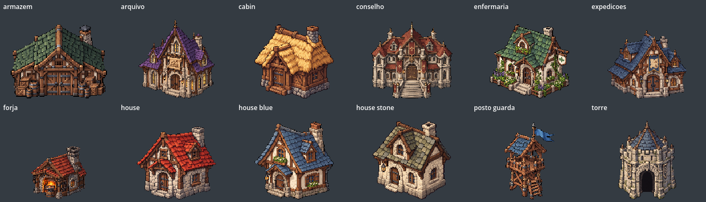
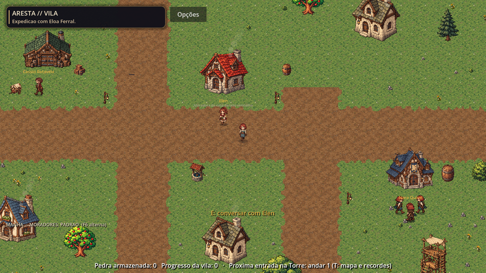

# Remodelagem dos cenarios

Entrega em 2026-10-06: 104 imagens geradas individualmente com OpenAI,
sem PixelForge, usando a linguagem visual das personagens como referencia.



- 12 edificios da vila.
- 53 objetos, mobiliario e marcos dos biomas.
- 26 decoracoes independentes: barris, arbustos, flores e pedras.
- 13 pisos opacos para vila, interiores e Torre.

Fontes em `art/raw/environment-v2/`; prompts, dimensoes e hashes anteriores
em `art/environment-remodel.json`. Os caminhos do runtime foram preservados.
Dois barris anteriormente recortados em 7-10 px de largura passaram a 33x40,
para que o obstaculo corresponda melhor a sua colisao. As demais dimensoes,
posicoes e regras de colisao nao foram alteradas.

Foram corrigidos enquadramento do barco, arco confundido com ponte,
cogumelo com porta, posto sem vitrificacao, arvore sem frutos e halo de flor.
Objetos usam alpha binario, ancora inferior e reducao nearest-neighbor.
Pisos tem texels de bordas opostas iguais; isso nao substitui inspecao visual
da repeticao. Atlas de caminhada de NPCs e inimigos estao documentados em
[animacoes-npcs-monstros.md](animacoes-npcs-monstros.md).

## Backup

Backup visual anterior, fora do repositorio:
`/Users/matheus/Documents/projects/backups/game-dev-2026-10-06-before-environment-remodel.tar.gz`.
Inclui sprites, catalogos e pipeline anteriores. SHA-256:
`c84a2742d506c9006df095a967f080a3d0eed8fc5effbf04153e2e55d99a39f5`.
Recuperar em outro diretorio e comparar antes de substituir arquivos.

## Reproduzir

```sh
node tools/art/sync_environment_pipeline.mjs
godot --headless --path . --script tools/art/audit_environment_sources.gd
godot --headless --path . --script tools/art/import_environment_remodel.gd
sh tools/release/import.sh
godot --headless --path . --script tests/environment_remodel_test.gd
godot --path . --script tools/art/environment_shots.gd
godot --path . --script tools/art/screenshot.gd
```

Pranchas de todos os sprites e pisos repetidos 3x3 ficam em `art/shots/`,
junto de capturas da vila, interiores e dez faixas da Torre.
O teste exige cobertura 104/104, dimensoes, transparencias, bordas,
imagens distintas e fontes protegidas no pipeline.

Importacao estrita aprovada. Suite isolada da entrega: 48 testes Godot,
zero falhas; automacao de releases: 17 testes Node, zero falhas. Pranchas
das quatro categorias e dez faixas da Torre inspecionadas por GPU.



## Limites

Decoracao e edificios continuam estaticos. Animacoes ambientais, transicoes
entre materiais de terreno, ataque/morte dos atores e QA com hordas no
hardware alvo continuam pendentes. Icones, audio e VFX curados em paralelo
nao foram regenerados nesta entrega. Isso nao declara o jogo pronto para Steam.
