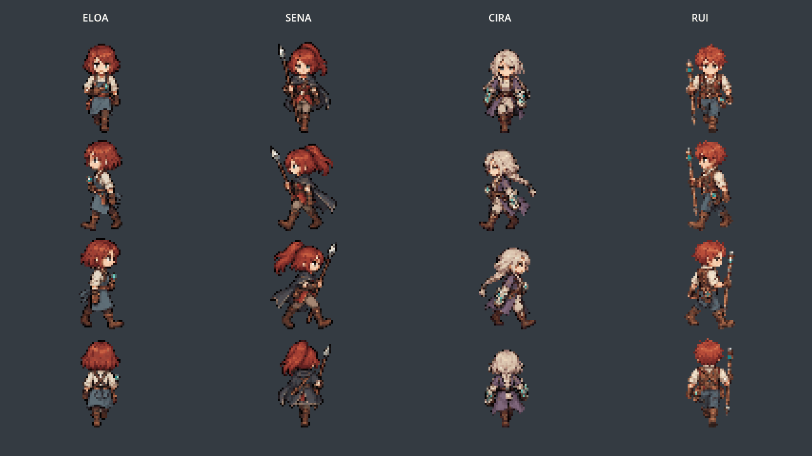

# Revisao de sprites e animacao

Atualizacao em 2026-10-06: os problemas de NPCs, inimigos e cenarios descritos
na revisao historica abaixo foram tratados nas entregas de
[animacoes](animacoes-npcs-monstros.md) e [104 cenarios](remodelagem-cenarios.md).
Ataque/morte e QA artistico com hordas permanecem pendentes.

Revisao em 2026-10-05. Backup completo do checkout anterior criado fora do
repositorio: `game-dev-2026-10-05-before-sprite-review-322c3a8.tar.gz`,
com .git, alteracoes locais, arte bruta, caches e builds. Arquivo gzip
validado; SHA-256 em arquivo adjacente. Nao publicar esse backup no GitHub.
Para recuperar, extrair em diretorio novo e comparar antes de substituir o jogo.

## Escopo revisado

255 PNGs inspecionados em folhas por categoria, com fundo quadriculado para
avaliar transparencia. Relatorios tecnicos antes/depois em `art/reviews/`;
eles registram dimensoes, limites do conteudo, alpha, cores e hash dos pixels.
Nenhum PNG vazio ou ilegivel na base. Apos a entrega: 259 PNGs, contando
quatro atlas novos. Integridade tecnica nao significa aprovacao artistica.

| Categoria | PNGs anteriores | Avaliacao |
| --- | ---: | --- |
| Personagens | 4 | Substituidos por arte v2 e caminhada nas quatro direcoes |
| Inimigos e chefes | 55 | Silhuetas variadas, mas ha cenarios, montagens e bases opacas indevidas; precisam de nova curadoria |
| NPCs | 17 | Ha personagens duplicados, miniaturas e objetos extras no mesmo sprite; substituicao prioritaria |
| Predios | 12 | Variacoes identificaveis; perspectiva, bases de terreno e objetos anexos ainda inconsistentes |
| Props | 52 | Misturam objetos isolados, kits e salas completas; revisar escala/colisao junto da arte |
| Decoracao | 26 | Varios arquivos contem conjuntos de objetos, nao uma unica peca; separar ou regenerar |
| Icones | 76 | Substituidos depois por icones de magia curados; ver assets-de-terceiros.md |
| Tiles | 13 | Opacos e validos; grama ruidosa e repeticao visivel precisam de passe de legibilidade |

Efeitos de combate animados agora existem em `assets/sprites/vfx/anim/`; veja
[assets-de-terceiros.md](assets-de-terceiros.md). As chaves estaticas de marcadores no
chao (impacto, agulha, pedra, santuario e gravidade) continuam com fallbacks
procedurais no runtime.

## Entrega de personagens

- Eloa, Sena, Cira e Rui: 16 quadros por personagem, quatro fases por direcao
  (frente, esquerda, direita, costas), 64 quadros no total.
- Novas imagens geradas com OpenAI image generation, sem usar PixelForge.
  Fontes preservadas em `art/raw/animations/`; identidade, arma e contrato
  da folha registrados em `art/animations.json`.
- Atlas de 256x256, celulas fixas de 64x64, conteudo de ate 48 px de altura,
  ancora dos pes (32,61), transparencia binaria e filtro nearest-neighbor.
  Uma escala unica por folha evita variacao de tamanho entre poses.
- Caminhada a 8 quadros/s; parado conserva a direcao e usa pose de passagem.
  O host transmite a direcao real do deslocamento no snapshot co-op.
  Dano, invulnerabilidade, sombras, pausa de marco e estado caido preservados.
- Retratos estaticos atualizados. A arma desenhada representa o kit inicial:
  foco, lanca, manoplas e bastao. Trocar equipamento ainda nao troca o desenho.
- Frames AtlasTexture ficam em cache; arte antiga e usada como fallback
  se um atlas nao existir. O teste de release exige os quatro atlas nos pacotes.
- Icones de Aegis por Acerto e Estabilidade Solida agora tem desenhos diferentes,
  escudo/impacto e estrutura apoiada. Demais icones ainda requerem curadoria.

## Proximas substituicoes

Prioridade alta: `npcs/lior_campelo`, `npcs/nara_quiral`, `npcs/oren_lumeiro`,
`npcs/tamar_vardal` e `npcs/comum_feirante` por figuras extras/cenarios;
`enemies/guardiao_da_comporta`, `enemies/guardiao_do_marco_cego`,
`enemies/ilha_pesada`, `enemies/marca_numerada`, `enemies/palpebra_do_horizonte`
e `enemies/pastor_das_correntes` por enquadramento de sala/base opaca.
`enemies/eco_regional` e `enemies/regente_centesimo` precisam de uma unica
silhueta inequivoca antes de animar.

Depois: converter decoracao em pecas realmente independentes, reduzir ruido
dos pisos e substituir props que
representam uma sala inteira (`props/escada_aberta`, `props/escada_selada`,
`props/campos_jardim_possivel`, `props/manto_poca_ambar`). Nao retirar fundo
automaticamente dessas imagens: isso pode apagar partes legitimas da arte.

`props/rocks`, obstaculo das Galerias Refeitas (andares 1 a 7), nao existia: o
jogo desenhava retangulos chapados no lugar. Agora e gerada por codigo, na
paleta do pilar e dos caixotes, com `godot --headless --path . --script tools/art/make_rocks.gd`
(o PixelForge estava fora do ar). `sprite_coverage_test` passou a exigir tile e
props de todos os biomas.

NPCs/inimigos continuam com animacao procedural nesta entrega. Ataque, dano,
esquiva e morte quadro a quadro nao foram gerados. Esta revisao nao declara
todo o pacote de arte pronto para a Steam.

## Reproduzir e validar

`godot --headless --path . --script tools/art/import_character_animations.gd`
reconstroi atlas/retratos a partir das fontes, sem API ou Forge.
`sh tools/art/process.sh characters` tambem preserva o pipeline novo.

`godot --headless --path . --script tools/art/audit_sprites.gd -- /diretorio/absoluto`
gera relatorio JSON e folhas de inspecao, sem alterar sprites.
`godot --path . --script tools/art/animation_shots.gd` captura os quatro ciclos
e verifica mudanca dos pixels. Capturas de QA ficam em `art/shots/` (ignoradas).

Testes `character_animation_test.gd` e `sprite_coverage_test.gd` verificam
64 poses distintas, recorte, alinhamento, cache, idle, direcao no snapshot,
259 imagens e cobertura dos catalogos de gemas, NPCs e Torre.
Inspecionadas tambem capturas reais da vila, interiores, menus e combate.
